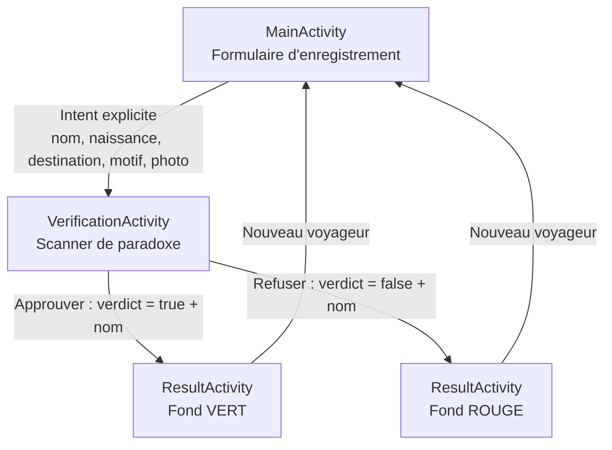
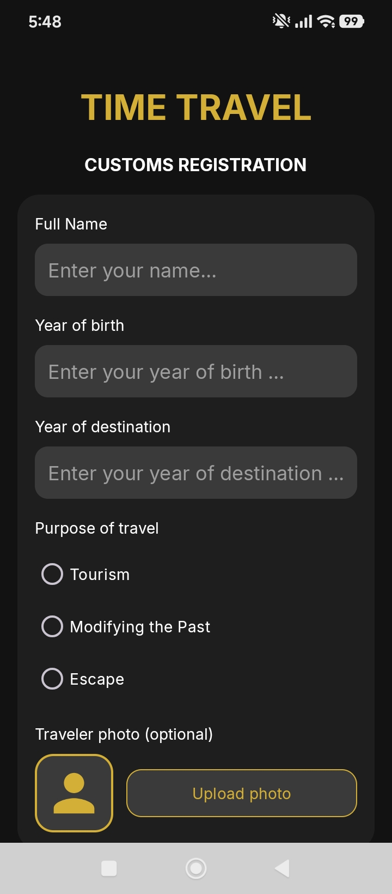

# ⏳ Douane Temporelle (Time Travel Customs)

Application Android qui simule un poste de douane pour les voyageurs du temps.

| | |
|---|---|
| **Établissement** | Faculté des Sciences Économiques et de Gestion de Tunis (FSEGT) |
| **Niveau** | 3ème année Business Intelligence (3ème BI) |
| **Groupe** | A01 |
| **Matière** | Programmation Mobile |
| **Enseignant** | Nidhal Jelassi |
| **Travail** | Mini Projet (DS 1) : « Douane Temporelle » |
| **Étudiant** | Youssef Rezgui |
| **Matricule utilisé pour les clés des `putExtra`** | `9898` |

---

## 1. Présentation

L'application suit le parcours d'un voyageur à la douane temporelle, en trois écrans :

1. **MainActivity** : le voyageur remplit le formulaire d'enregistrement.
2. **VerificationActivity** : l'agent inspecte le « passeport temporel » et décide.
3. **ResultActivity** : le verdict final s'affiche (vert = approuvé, rouge = refusé).

Technologies : Java, Android Studio, Material Components, `Intent` explicites.

---

## 2. Workflow global



Les données passent d'une activité à l'autre uniquement avec des `Intent` explicites. Toutes les clés des `putExtra` sont construites par des méthodes statiques qui prennent le matricule en paramètre (voir §6).

---

## 3. Activité 1 : le formulaire d'enregistrement (`MainActivity`)

**Interface** : un formulaire (dans une carte sombre) avec :
- le nom du voyageur (`EditText`) ;
- l'année de naissance (`EditText` numérique) ;
- l'année de destination (`EditText` numérique) ;
- le motif du voyage (`RadioGroup`) : *Tourism*, *Modifying the Past*, *Escape* ;
- la photo du voyageur (optionnelle) : bouton **Upload photo** + aperçu ;
- le bouton **Inspect Profile**.

**Ce que fait le code :**
1. Il récupère les valeurs des champs.
2. Il contrôle les données (voir §5, validations).
3. Il crée un `Intent` explicite vers `VerificationActivity`, y met les données avec des clés construites par `keyName(...)`, `keyBirth(...)`, `keyDest(...)`, `keyPurpose(...)` et `keyPhoto(...)`, puis lance l'activité.

| Capture : haut du formulaire | Capture : bas du formulaire |
|---|---|
|  |  |

---

## 4. Activité 2 : le scanner de paradoxe (`VerificationActivity`)

**Interface** : un « passeport temporel ».
- Racine : `LinearLayout` **horizontal**.
- À gauche : une `ImageView` (la photo) avec `layout_weight="0.3"`.
- À droite : un `RelativeLayout` avec `layout_weight="0.7"` qui contient tous les textes.
- Les deux enfants ont `layout_width="0dp"` pour que les poids soient respectés.

**Ce que fait le code :**
1. Il lit les données reçues (nom, naissance, destination, motif, photo).
2. Il calcule l'**âge temporel** : `année de destination − année de naissance`.
3. Il affiche le résumé complet dans le passeport.
4. **Règle du paradoxe** : si le motif est *Modifying the Past* **et** que l'âge temporel est un nombre premier, le bouton **Approve** est désactivé (`setEnabled(false)`) dès le chargement. Un tampon rouge *PARADOX RISK - APPROVAL BLOCKED* s'affiche. Sinon, un tampon vert *NO PARADOX DETECTED* s'affiche.
5. Deux boutons : **Approve the time jump** (vert) et **Refuse (Paradox risk)** (rouge). Chacun lance `ResultActivity` avec un `Intent` explicite qui transporte le verdict (booléen) **et** le nom du voyageur.


---

## 5. Activité 3 : le verdict (`ResultActivity`)

- Écran très simple : un titre, un message personnalisé et un bouton.
- **Le fond change selon le verdict** : vert si approuvé, rouge si refusé.
- Messages : `Safe Travel [Nom]!` si approuvé, `[Nom] is under temporal arrest` si refusé.
- Le bouton **New traveler** relance `MainActivity` avec les flags `FLAG_ACTIVITY_NEW_TASK | FLAG_ACTIVITY_CLEAR_TASK` : les activités précédentes sont fermées et le formulaire revient vide.

| Approuvé | Refusé |
|---|---|
|  |  |

---

## 6. Respect des contraintes de l'énoncé

| Contrainte | Comment elle est respectée |
|---|---|
| `VerificationActivity` : `LinearLayout` horizontal racine, image à gauche (poids 0.3) et `RelativeLayout` à droite (poids 0.7) pour les textes | `activity_verification.xml` : `ImageView` et `RelativeLayout` en `0dp` avec `layout_weight` 0.3 et 0.7 |
| Clés des `putExtra` préfixées par les 4 derniers chiffres de la carte étudiant, construites par une méthode statique qui prend le matricule en paramètre | `MainActivity.keyName/keyBirth/keyDest/keyPurpose/keyPhoto(String matricule)` et `VerificationActivity.keyVerdict(String matricule)`, avec `MATRICULE = "9898"`. Exemple : `9898_NOM_VOYAGEUR` |
| Motif *Modification du passé* et différence prime : **Approve** désactivé dès le chargement | `isPrime(age)` dans `VerificationActivity.onCreate`, puis `btnApprove.setEnabled(false)` |
| IDs de chaque `TextView`, `EditText`, `Button` avec les initiales d'un étudiant | Tous les IDs se terminent par `_yr` (Youssef Rezgui), par exemple `et_name_yr`, `btn_inspect_yr`, `tv_status_yr` |
| Code commenté en arabe (avec les chiffres) | Commentaires en arabizi (3, 7, 9…) dans le code Java |
| Intent explicites entre les trois activités | `new Intent(this, XxxActivity.class)` |
| Le verdict (booléen) **et** le nom sont envoyés à l'Activité 3 | `putExtra(keyVerdict(...), approved)` et `putExtra(keyName(...), name)` |
| Retour à `MainActivity` en fermant les activités précédentes | `FLAG_ACTIVITY_NEW_TASK \| FLAG_ACTIVITY_CLEAR_TASK` |

---

## 7. Fonctionnalités ajoutées (non demandées dans l'énoncé)

### 7.1 Photo du voyageur (galerie)
- **Dans l'Activité 1** : le bouton **Upload photo** ouvre la galerie avec le **Photo Picker** du système (`ActivityResultContracts.PickVisualMedia`). Aucune permission n'est nécessaire et aucune base de données non plus. L'aperçu s'affiche juste à côté du bouton. La photo est **optionnelle**.
- **Transfert** : l'`Uri` de l'image est envoyé dans l'`Intent` avec la clé `keyPhoto(MATRICULE)`. On ajoute aussi un `ClipData` et le flag `FLAG_GRANT_READ_URI_PERMISSION` pour que l'activité suivante puisse lire l'image.
- **Dans l'Activité 2** : la photo remplit le cadre à gauche (`centerCrop`). Sans photo, une silhouette dorée s'affiche. Le voyageur peut aussi **toucher la photo** pour la changer depuis la galerie.
- La photo n'est conservée qu'en mémoire pendant le parcours. Pas de stockage persistant, car ce n'est pas nécessaire ici.

### 7.2 Contrôle : « Modification du passé » avec une date qui n'est pas dans le passé
- L'application connaît l'année actuelle grâce à `Calendar` (date du téléphone).
- Si le motif est *Modifying the Past* et que l'année de destination est **supérieure ou égale à l'année actuelle**, l'application bloque l'enregistrement et affiche un message d'erreur qui dit quoi changer : *« Modifying the Past needs a destination year before 2026 (the current year). Change the destination year, or change the purpose of travel. »*
- L'année dans le message est calculée automatiquement.

### 7.3 Autres contrôles et améliorations
- **Champs vides** : message d'erreur si un champ obligatoire manque ou si aucun motif n'est choisi.
- **Ordre des années** : l'année de destination doit être **après** l'année de naissance, sinon l'âge temporel serait nul ou négatif.
- **Nom nettoyé** avec `trim()` (un nom de seulement des espaces est refusé).
- **Design** : thème sombre avec la couleur dorée `@color/gold` ; vert et rouge pour le verdict ; passeport avec cadre doré ; tampon vert ou rouge dans le passeport.
- **Bouton Approve** gris quand il est désactivé (`res/color/btn_approve_tint.xml`).
- **Barres système** : `fitsSystemWindows` pour que le contenu et les boutons ne se collent pas aux boutons de navigation du téléphone.
- **Textes dans `strings.xml`** (pas codés en dur dans les layouts).

---

## 8. Scénarios de test

| Scénario | Données | Résultat attendu |
|---|---|---|
| Voyage normal | Tourism, 2004 → 2050 | Âge 46 ans, tampon vert, **Approve** actif |
| Motif *Modifying the Past* avec date future | Modifying the Past, 1990 → 2050 | Message d'erreur dans l'Activité 1, on reste sur le formulaire |
| Paradoxe (différence première) | Modifying the Past, 1990 → 2003 (différence 13, premier) | **Approve** désactivé et tampon rouge dès l'ouverture de l'Activité 2 |
| Modification du passé sans paradoxe | Modifying the Past, 1990 → 2000 (différence 10, non premier) | Tampon vert, **Approve** actif |
| Années incohérentes | Naissance 2000, destination 1990 | Message d'erreur (destination après naissance) |
| Photo | Upload photo → Inspect | La photo choisie apparaît dans le passeport |
| Verdict | Approve / Refuse | Écran vert / rouge avec le message et le nom |
| Nouveau voyageur | Bouton **New traveler** | Retour au formulaire vide, activités précédentes fermées |

---

## 9. Structure du projet

```
TimeTravelCustoms/
├── app/src/main/
│   ├── java/youssef/rezgui/timetravelcustoms/
│   │   ├── MainActivity.java            # Activité 1 : formulaire
│   │   ├── VerificationActivity.java    # Activité 2 : passeport / scanner de paradoxe
│   │   └── ResultActivity.java          # Activité 3 : verdict
│   ├── res/layout/
│   │   ├── activity_main.xml
│   │   ├── activity_verification.xml
│   │   └── activity_result.xml
│   ├── res/values/    (strings.xml, colors.xml, themes.xml)
│   ├── res/drawable/  (fonds, tampons, silhouette)
│   ├── res/color/     (btn_approve_tint.xml)
│   └── AndroidManifest.xml
└── screenshots/
```

---

## 10. Lancer le projet

1. Ouvrir le dossier avec **Android Studio**.
2. Attendre la synchronisation Gradle.
3. Lancer sur un émulateur ou un téléphone Android (API 24 ou plus).
